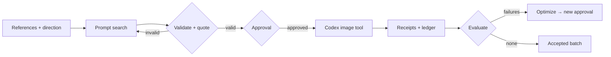

# Image Factory

## Plugin marketplaces

This plugin belongs to **AIGC content creation**.

| Category | Marketplace | Purpose |
| --- | --- | --- |
| Full-stack development | [Full Stack Plugins](https://github.com/partme-ai/full-stack-plugins) | Architecture and UI design, code understanding, quality checks, code review, workflow governance, and server operations |
| AIGC content creation | [Full AIGC Plugins](https://github.com/partme-ai/full-aigc-plugins) | Image, video, audio, music, 3D, and multimodal content creation |


> Turn a reference-driven image task into an auditable production run: a validated plan, an approved spend, and a hash-verified receipt for every artifact.

[](https://github.com/full-aigc-plugins/image-factory-plugin/releases)
[](#installation)
[](#skills)
[](LICENSE)

[English](README.md) | [简体中文](README.zh-CN.md) · [Install](#installation) · [Quick start](#quick-start) · [Skills](#skills) · [Troubleshooting](#troubleshooting)

## Positioning

`image-factory` produces verifiable image batches. It turns references and a visual direction into a validated plan, quotes the batch, waits for your approval, generates one image per plan item through the host's image tool, and records a recomputed hash, size, and dimension receipt for every file.

The plugin exposes two layers. In Codex the built-in `imagegen` / `image_gen` path is preferred and needs no provider key. The unchanged Baoyu workflows are offered only after an explicitly observed image-quota exhaustion in Codex, or on a host without a verified native image capability. The Factory loop adds the governed batch: plan validation, approval, receipts, evaluation, and recovery.

| Property | Value |
| --- | --- |
| Plugin ID | `image-factory` |
| Plugin manifest version | `0.8.0` |
| npm package metadata | `0.9.0` |
| Maturity | No production-readiness claim; the newest runtime record covers the `0.8.0` candidate |
| Runtime | Python 3.11+, standard library only |
| MCP server | None; the manifest declares no MCP entry |

`0.8.0` added multi-hash evidence, stratified calibration, a review workspace, and a runtime acceptance matrix. The paid 4/8/12, cross-host, and fault-injection cases remain `NOT_RUN`; synthetic tests do not establish live character, prop, or style stability.

## Installation

### Prerequisites

- Python 3.11 or newer on `PATH`.
- The Codex CLI reachable on `PATH`, or `CODEX_HOME` pointing at an installation.
- Factory-only batches need no API key and no npm package.
- The Baoyu fallback requires `bun` or `npx` plus whatever credential the selected provider documents; the `codex-cli` provider reuses an already signed-in Codex CLI.

### From the plugin marketplace

```bash
codex plugin marketplace add partme-ai/full-aigc-plugins
codex plugin add image-factory@full-aigc-plugins
```

### From the repository-local marketplace

The tagged `v0.9.1` marketplace installation is separate from this checkout's `0.8.0` plugin manifest.

```bash
codex plugin marketplace add full-aigc-plugins/image-factory-plugin --ref v0.9.1
codex plugin add image-factory@partme-ai-image-factory
```

Restart Codex or the ChatGPT desktop app and open a new task so the skills load.

For development, clone the repository and run `bin/image-factory probe`; it prints a JSON capability report for Python, the Codex CLI, and ledger access and never prints a secret value. `codex plugin list` should show `image-factory@partme-ai-image-factory  installed, enabled`.

## Quick start

1. Find an attributed prompt direction offline:

```bash
bin/image-factory prompt-search 'storybook illustration' --limit 3 --json
```

2. Write a batch plan, then validate and quote it. Validation rejects unknown fields, cap violations, and duplicate idempotency keys before anything is spent:

```bash
bin/image-factory validate-plan image-plan.json
bin/image-factory quote image-plan.json
```

3. Review the quote and explicitly approve spending for this run (`--approve` is a flag, not an approval-file path):

```bash
bin/image-factory run --plan image-plan.json --job image-plan.job.json --approve
```

4. Evaluate with recorded scores, or reconcile an interrupted run without generating again:

```bash
bin/image-factory evaluate --plan image-plan.json --job image-plan.job.json --scores image-scores.json
bin/image-factory recover --plan image-plan.json --job image-plan.job.json
```

Each attempt is a fresh streaming subprocess against the built-in image tool. There is no retry loop: a silent retry is how one bad prompt becomes a large bill. A failed item is terminal; `optimize` produces a new prompt round that needs its own approval.

## What you can build

| Workflow | Built-in path | Verifiable output |
| --- | --- | --- |
| Find a direction | `prompt-search` over bundled templates | Ranked prompt directions with source attribution |
| Produce a governed batch | `validate-plan` → `quote` → `run` | Per-artifact hash, size, and dimension receipts |
| Keep a series consistent | `consistency_profile`, entity traits, role-aware references | Effective prompt and reference count reported by `quote` |
| Evaluate and iterate | `evaluate` + `image-factory-review` | Deterministic gate results, advisory dimension scores, next-round plan |
| Recover an interrupted run | `recover` | Reconciled ledger without another generation call |
| Make one ad-hoc image | Codex built-in `imagegen` | A bitmap asset outside the Factory ledger |

Multi-image stories declare `consistency_profile`; anchors are injected into every selected frame in a fixed order and `story_state` compiles locks and transitions into the effective prompt. Anchors improve control but cannot guarantee model-level identity.

## Skills

| Skill | Purpose |
| --- | --- |
| `image-factory-use` | Picks the entry point for a batch request and never performs the work itself |
| `image-factory-run` | Validates, quotes, obtains approval, generates one image per item, and collects receipts |
| `image-factory-judge` | Runs deterministic gates, records advisory scores beside human labels, and writes the next round |
| `image-factory-review` | Writes the independent dimensioned advisory document consumed by `evaluate` and `optimize` |
| `image-factory-recover` | Reads the ledger and maps an interrupted or unknown batch to the single legal next step |
| `image-factory-harness` | Chooses Codex `imagegen` first, Baoyu only after quota evidence, and normalizes delivery evidence |
| `imagegen` | Managed snapshot of the Codex raster-image generation and editing instructions |
| `baoyu-image-gen` | Vendored multi-provider image generation through `bun` or `npx` |
| `baoyu-cover-image` | Vendored article-cover generation across aspect ratios |
| `baoyu-xhs-images` | Vendored social image-card series generation |

The three Baoyu skills come from `baoyu-skills v2.5.2`, while `imagegen` and `image-factory-use/run/judge/recover` come from `image-factory-skills v1.1.0`; both sets are pinned in `skills.lock.json`. `image-factory-harness` and `image-factory-review` are plugin-local. Edit none of these copies in place.

## Slash commands

| Command | What it does |
| --- | --- |
| `/image-factory` | Total entry point; routes to run, judge, or recover |
| `/image-factory-run` | Quotes, approves, generates, and collects receipts for a batch |
| `/image-factory-judge` | Evaluates a finished batch and drives prompt optimization |
| `/image-factory-recover` | Restores an interrupted batch from the job ledger |

## Configuration

| Setting | Where it lives | Notes |
| --- | --- | --- |
| Codex home | `CODEX_HOME` environment variable | Defaults to the standard Codex location |
| Job ledger | The `--job` path, or `<plan>.job.json` | Plain JSON written atomically |
| Receipts | `<job>.receipts/` | One JSON file per artifact |
| Job lock | `<job>.lock` | Cross-process advisory lock |
| Credentials | None | The plugin stores no secret and the ledger rejects credential-like keys |
| Baoyu provider | Local environment or provider config | Chosen by the user, never written by the plugin |

Exit codes are `0` success, `1` failure, `2` usage error, `3` approval required, `4` capability unavailable, `5` job locked, and `6` recovery required.

## Architecture and security



| Component | Owns | Does not own |
| --- | --- | --- |
| `bin/image-factory` | CLI entry point | Business rules |
| `scripts/plan_validator.py` | Closed plan schema, caps, idempotency keys | Prompt quality |
| `scripts/generation_runner.py` | One fresh subprocess per attempt | Retry policy |
| `scripts/job_ledger.py`, `scripts/receipt_store.py` | Durable state, scrubbing, per-artifact re-verification | Remote lifetime |
| `skills/` (10) | Routing, governance, and review instructions | Runtime enforcement |

Authentication is Codex's own. The Factory path never calls an external generation API, never updates an upstream dependency on its own, and never writes a credential: the ledger rejects credential-like keys before writing anything. Reference inputs are validated before use, and every hash, size, and dimension is recomputed from disk with a second check that catches a file rewritten mid-validation.

## Troubleshooting

| Symptom | Check first | Resolution |
| --- | --- | --- |
| `probe` reports the Codex CLI missing | `PATH` or `CODEX_HOME` | Point `CODEX_HOME` at the installation or fix `PATH` |
| Plan validation fails | The plan schema | Fix the named field; unknown fields are rejected on purpose |
| The run refuses to start | The approval file | Quote the plan again and approve the new revision |
| A run stops mid-batch | Ledger state | Run `recover`; verified receipts are reconciled, not regenerated |
| Hash verification fails | The artifact on disk | Treat it as a hard failure: the file changed after generation |
| The image quota is exhausted | Codex quota evidence | Only then choose a Baoyu fallback and configure its provider locally |
| Generation runs on Linux or Windows | Platform support | The generation path is verified on macOS only; elsewhere it stays `NOT_RUN` |
| A model name is missing from receipts | Platform boundary | The model is chosen by Codex; receipts record only what Codex reports |

## Upgrade

```bash
codex plugin marketplace upgrade partme-ai-image-factory
codex plugin add image-factory@partme-ai-image-factory
```

## Contributing and support

Open functional issues at <https://github.com/full-aigc-plugins/image-factory-plugin/issues>. Before proposing a change, state the Python version you verified on, whether it alters the plan schema or the ledger format, and include the affected gates.

## License

Apache-2.0 — see [LICENSE](LICENSE), [NOTICE](NOTICE), and [THIRD_PARTY_NOTICES.md](THIRD_PARTY_NOTICES.md). Vendored Baoyu skills and the `imagegen` snapshot keep their upstream terms.
