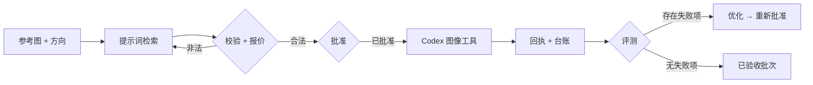

# Image Factory

## 插件市场导航

本插件所属分类：**AIGC 内容创作**。

| 分类 | 插件市场入口 | 用途 |
| --- | --- | --- |
| 全栈开发 | [Full Stack Plugins](https://github.com/partme-ai/full-stack-plugins) | 架构与 UI 设计、代码理解、质量检查、代码审查、流程治理与服务器运维 |
| AIGC 内容创作 | [Full AIGC Plugins](https://github.com/partme-ai/full-aigc-plugins) | 图像、视频、音频、音乐、3D 与多模态内容创作 |


> 把「给一批参考图、定一个视觉方向」变成一次可审计的生产：计划先校验、花费先批准、每件产物都有可复核的哈希回执。

[](https://github.com/full-aigc-plugins/image-factory-plugin/releases)
[](#安装)
[](#技能)
[](LICENSE)

[English](README.md) | [简体中文](README.zh-CN.md) · [安装](#安装) · [快速开始](#快速开始) · [技能](#技能) · [故障排查](#故障排查)

## 项目定位

`image-factory` 用来生产可核验的批量图片。它把参考图和视觉方向变成一份已校验的计划，先报价，等你批准，再由宿主的图像工具逐项生成，最后为每个文件重新计算哈希、大小与尺寸并写入回执。

插件提供两层能力。在 Codex 中优先使用内置 `imagegen` / `image_gen`，不需要 Provider Key；只有在明确观测到图片额度耗尽时，才会在 Codex 中提供原样的 Baoyu 工作流，或者在没有可验证原生出图能力的宿主上考虑它。Factory 闭环负责受治理的批次：计划校验、批准、回执、评测与恢复。

| 项目 | 值 |
| --- | --- |
| 插件 ID | `image-factory` |
| 版本 | `0.9.1+codex.20261018` |
| 成熟度 | 未宣称生产就绪；最新的真实运行记录对应 `0.8.0` 候选版本 |
| 运行环境 | Python 3.11 及以上，仅用标准库 |
| MCP 服务器 | 无；清单中没有 MCP 条目 |

`0.8.0` 增加了多哈希证据、分层校准、审片工作区和真实运行验收矩阵。真实付费 4/8/12、跨宿主与故障注入用例仍为 `NOT_RUN`；合成测试不能证明真实人物、道具或画风稳定性。

## 安装

### 前置条件

- `PATH` 上有 Python 3.11 或更新版本。
- Codex CLI 在 `PATH` 上可达，或用 `CODEX_HOME` 指向其安装位置。
- 只跑 Factory 批次时不需要 API Key，也不需要 npm 包。
- Baoyu 降级需要 `bun` 或 `npx`，以及所选 Provider 文档要求的凭据；`codex-cli` Provider 复用已登录的 Codex CLI。

### 从插件市场安装

```bash
codex plugin marketplace add partme-ai/full-aigc-plugins
codex plugin add image-factory@full-aigc-plugins
```

### 从仓库内置市场安装

```bash
codex plugin marketplace add full-aigc-plugins/image-factory-plugin --ref v0.9.1
codex plugin add image-factory@partme-ai-image-factory
```

重启 Codex 或 ChatGPT 桌面应用，新建任务以加载技能。

二次开发可直接克隆仓库并执行 `bin/image-factory probe`；它会输出 Python、Codex CLI 与台账访问能力的 JSON 报告，且不打印任何秘密值。`codex plugin list` 应显示 `image-factory@partme-ai-image-factory  installed, enabled`。

## 快速开始

1. 离线检索带出处的提示词方向：

```bash
bin/image-factory prompt-search 'storybook illustration' --limit 3 --json
```

2. 写批次计划，先校验再报价。校验会在花费之前拒绝未知字段、超限和重复幂等键：

```bash
bin/image-factory validate-plan image-plan.json
bin/image-factory quote image-plan.json
```

3. 批准确切的计划哈希后执行：

```bash
bin/image-factory run image-plan.json --approval image-approval.json
```

4. 评测，或核对中断的运行：

```bash
bin/image-factory evaluate image-plan.json
bin/image-factory recover image-plan.json
```

每次尝试都是针对内置图像工具的全新流式子进程。这里没有重试循环：静默重试正是「一个坏提示词变成一张大账单」的成因。失败项是终态，`optimize` 会生成需要重新批准的新一轮提示词。

## 可完成的工作

| 工作流 | 内置路径 | 可验证输出 |
| --- | --- | --- |
| 找方向 | 对内置模板执行 `prompt-search` | 带来源标注的提示词方向排序 |
| 生产受治理批次 | `validate-plan` → `quote` → `run` | 逐产物的哈希、大小与尺寸回执 |
| 保持系列一致 | `consistency_profile`、实体特征、角色化参考图 | `quote` 报告的实际提示词与参考图数量 |
| 评测与迭代 | `evaluate` + `image-factory-review` | 确定性门禁结果、参考性维度评分、下一轮计划 |
| 恢复中断运行 | `recover` | 核对后的台账，不额外调用生成 |
| 临时出一张图 | Codex 内置 `imagegen` | Factory 台账之外的位图产物 |

多图故事应声明 `consistency_profile`；锚点按固定顺序注入每一帧，`story_state` 把锁定项与镜头转换编译进实际提示词。锚点能提升可控性，但不承诺底层模型的身份一致性。

## 技能

| 技能 | 作用 |
| --- | --- |
| `image-factory-use` | 为批次请求选择入口，本身不执行具体工作 |
| `image-factory-run` | 校验、报价、取得批准、逐项生成并采集回执 |
| `image-factory-judge` | 运行确定性门禁，把参考性评分与人工标注并列记录，并写出下一轮 |
| `image-factory-review` | 产出供 `evaluate` 与 `optimize` 消费的独立分维度评审文档 |
| `image-factory-recover` | 读取台账，把中断或状态不明的批次映射到唯一合法下一步 |
| `image-factory-harness` | 优先选择 Codex `imagegen`，仅在额度证据出现后使用 Baoyu，并规范化交付证据 |
| `imagegen` | Codex 位图生成与编辑指令的受管快照 |
| `baoyu-image-gen` | 经 `bun` 或 `npx` 调用的多 Provider 出图 |
| `baoyu-cover-image` | 多画幅文章封面生成 |
| `baoyu-xhs-images` | 社交图片卡片系列生成 |

三个 Baoyu 技能来自 `baoyu-skills v2.5.2`，`imagegen` 与 `image-factory-use/run/judge/recover` 来自 `image-factory-skills v1.1.0`，两组都由 `skills.lock.json` 固定；`image-factory-harness` 与 `image-factory-review` 为插件自有。以上副本都不要就地修改。

## 斜杠命令

| 命令 | 作用 |
| --- | --- |
| `/image-factory` | 总入口，按情况路由到运行、评测或恢复 |
| `/image-factory-run` | 对批次报价、批准、生成并采集回执 |
| `/image-factory-judge` | 评测已完成批次并驱动提示词优化 |
| `/image-factory-recover` | 从任务台账恢复中断的批次 |

## 配置

| 设置 | 所在位置 | 说明 |
| --- | --- | --- |
| Codex 主目录 | `CODEX_HOME` 环境变量 | 默认为 Codex 的标准位置 |
| 任务台账 | `--job` 路径，或 `<plan>.job.json` | 纯 JSON，原子写入 |
| 回执 | `<job>.receipts/` | 每件产物一个 JSON 文件 |
| 任务锁 | `<job>.lock` | 跨进程建议锁 |
| 凭据 | 无 | 插件不保存秘密，台账会拒绝形似凭据的键 |
| Baoyu Provider | 本机环境变量或 Provider 配置 | 由用户选择，插件不写入 |

退出码为 `0` 成功、`1` 失败、`2` 用法错误、`3` 需要批准、`4` 能力不可用、`5` 任务被锁定、`6` 需要恢复。

## 架构与安全



| 组件 | 负责 | 不负责 |
| --- | --- | --- |
| `bin/image-factory` | CLI 入口 | 业务规则 |
| `scripts/plan_validator.py` | 封闭计划 schema、上限、幂等键 | 提示词质量 |
| `scripts/generation_runner.py` | 每次尝试一个全新子进程 | 重试策略 |
| `scripts/job_ledger.py`、`scripts/receipt_store.py` | 持久状态、密钥清洗、逐产物复核 | 远端生命周期 |
| `skills/`（10 个） | 路由、治理与评审指令 | 运行时强制 |

认证由 Codex 自身完成。Factory 路径不调用外部生成 API，不自行升级上游依赖，也不写入任何凭据：台账在落盘前会拒绝形似凭据的键。参考输入在使用前会校验，每个哈希、大小与尺寸都从磁盘重算，并做二次检查以发现验证窗口内被改写的文件。

## 故障排查

| 现象 | 优先检查 | 处理方式 |
| --- | --- | --- |
| `probe` 报告 Codex CLI 缺失 | `PATH` 或 `CODEX_HOME` | 用 `CODEX_HOME` 指向安装位置，或修正 `PATH` |
| 计划校验失败 | 计划 schema | 修正被点名的字段；未知字段是有意拒绝的 |
| 运行拒绝启动 | 批准文件 | 重新报价并批准新的 revision |
| 批次中途停止 | 台账状态 | 执行 `recover`；已核验回执会被核对而不是重做 |
| 哈希校验失败 | 磁盘上的产物 | 视为硬失败：文件在生成之后被改动过 |
| 图片额度耗尽 | Codex 额度证据 | 此时才选择 Baoyu 降级，并在本机配置其 Provider |
| 在 Linux 或 Windows 上生成 | 平台支持 | 生成路径只在 macOS 上验证过，其他平台保持 `NOT_RUN` |
| 回执里没有模型名 | 平台边界 | 模型由 Codex 决定；回执只记录 Codex 告知的内容 |

## 升级

```bash
codex plugin marketplace upgrade partme-ai-image-factory
codex plugin add image-factory@partme-ai-image-factory
```

## 贡献与支持

功能问题请提交到 <https://github.com/full-aigc-plugins/image-factory-plugin/issues>。提交变更前，请说明你验证所用的 Python 版本、是否改动计划 schema 或台账格式，并附上受影响的门禁。

## 许可证

Apache-2.0，见 [LICENSE](LICENSE)、[NOTICE](NOTICE) 与 [THIRD_PARTY_NOTICES.md](THIRD_PARTY_NOTICES.md)。vendor 的 Baoyu 技能与 `imagegen` 快照保留其上游条款。
